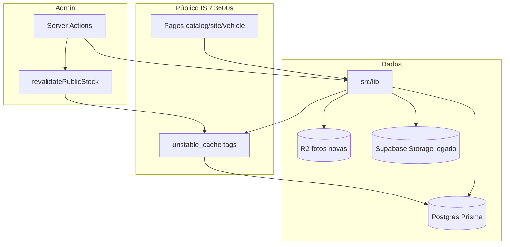

# Guia para IAs e desenvolvedores — Garagem

Este documento é o **mapa do repositório**: como o sistema funciona, onde cada coisa mora, o que pode ser alterado com segurança e quais regras nunca podem quebrar.

Use-o quando trabalhar com **Cursor, Claude Code, Codex, ChatGPT, Copilot, Antigravity** ou qualquer outra IA. As regras obrigatórias de agente continuam em **[`AGENTS.md`](../AGENTS.md)** (fonte da verdade). Comece pelo [`PRIMEIROS-PASSOS-IA.md`](PRIMEIROS-PASSOS-IA.md). O [`CLAUDE.md`](../CLAUDE.md), [`GEMINI.md`](../GEMINI.md) e [`.cursor/rules/`](../.cursor/rules/) só reforçam o `AGENTS.md`.

---

## Como usar este guia (prompt sugerido)

Cole no início da conversa com qualquer IA:

```text
Projeto: garagem-site (loja Garagem, Linhares/ES).
Leia e siga AGENTS.md na raiz.
Leia docs/PRIMEIROS-PASSOS-IA.md e docs/GUIA-PARA-IAS-E-DESENVOLVEDORES.md.
Não altere produção (banco, Vercel env, download de fotos em suagaragem.net).
Responda e comente em português do Brasil.
```

---

## 1. O que é este projeto

| Item | Valor |
| --- | --- |
| Produto | Site público de seminovos + painel administrativo |
| Produção | https://www.suagaragem.net |
| Stack | Next.js 16 (App Router), React 19, Tailwind 3, Prisma 6, Postgres (Supabase `sa-east-1`), deploy Vercel Hobby em `gru1` |
| Domínio da marca | **Garagem** (não usar "Sua Garagem" em textos novos visíveis) |

O site não é um vitrine estática: há **estoque com cache**, **ficha com SEO/JSON-LD**, **feed Meta para anúncios**, **assistente (chat)**, **upload de fotos** (R2 + legado Supabase), **leads**, **vendas**, **FIPE**, **promissórias**, **hub `/links`**, etc.

---

## 2. Hierarquia da documentação

| Documento | Quando ler |
| --- | --- |
| **[`PRIMEIROS-PASSOS-IA.md`](PRIMEIROS-PASSOS-IA.md)** | Loop de 2 min (conflitos, branch, proibições) |
| **[`AGENTS.md`](../AGENTS.md)** | Sempre, antes de codar ou abrir PR |
| **Este guia** | Arquitetura, pastas, padrões, o que mexer / não mexer |
| **[`GLOSSARIO.md`](GLOSSARIO.md)** | Termos de negócio e técnicos do repo |
| **[`ANTI-PATTERNS.md`](ANTI-PATTERNS.md)** | Erros típicos de IA (revisar antes do push) |
| **[`ONDE-ESTA.md`](ONDE-ESTA.md)** | Atalho “onde acho X no código?” |
| **[`docs/README.md`](README.md)** | Índice mestre de toda documentação |
| **[`areas/README.md`](areas/README.md)** | Guias por área (home, estoque, ficha, seo, chat, meta, admin, infra…) |
| **[`TESTES.md`](TESTES.md)** | Qual teste unitário rodar |
| **[`E2E-PARA-IAS.md`](E2E-PARA-IAS.md)** | Playwright: setup e specs por mudança |
| **[`../CONTRIBUTING.md`](../CONTRIBUTING.md)** | Contribuição humana + agentes |
| **[`prompts/README.md`](prompts/README.md)** | Textos prontos para Cursor, Claude, ChatGPT, Codex |
| **[`decisions/README.md`](decisions/README.md)** | ADRs — por que a arquitetura é assim |
| **[`runbooks/README.md`](runbooks/README.md)** | Preview Vercel, migrations, Meta catalog |
| **[`CHANGELOG-AGENTES.md`](CHANGELOG-AGENTES.md)** | Mudanças de processo para bots |
| **[`README.md`](../README.md)** | Setup local, comandos rápidos, regras resumidas |
| **[`docs/ops.md`](ops.md)** | Vercel, Meta, imagens, deploys, performance |
| **[`supabase/README.md`](../supabase/README.md)** | Migrations SQL (única pasta oficial) |
| **[`e2e/README.md`](../e2e/README.md)** | Percursos Playwright |
| **[`pesquisas/INDICE.md`](pesquisas/INDICE.md)** | Índice dos relatórios Codex |
| **`docs/pesquisas/`** | Relatórios do Codex (diagnóstico; Codex **não** altera código) |
| **`docs/admin/implementacao.md`** | Contexto histórico do painel (referência) |
| **`.github/pull_request_template.md`** | Checklist ao abrir PR |
| **`.github/ISSUE_TEMPLATE/`** | Issues com área e agente |

Se uma IA sugerir algo que contradiz `AGENTS.md` ou este guia, **a documentação do repo vence**.

---

## 3. Mapa de pastas

```
src/app/
  (catalog)/          → Home (/), estoque (/estoque), marca/modelo
  (site)/             → Páginas institucionais: sobre, FAQ, vender, pedido, guias, cidades…
  (vehicle)/          → Ficha: /estoque/[id]
  admin/              → Painel (login, veículos, vendas, leads, site, compra…)
  api/                → Route Handlers (chat, fotos, upload, admin, meta, cron…)
  links/, offline/    → Hub bio, PWA offline

src/components/
  site/               → UI pública (SiteHeader, cards, filtros…)
  admin/              → UI do painel (excluída do Tailwind do site — ver §8)
  (raiz)              → Compartilhados: JsonLd, analytics, consentimento…

src/lib/              → Regras de negócio + testes (*.test.ts) — priorize mudanças aqui
prisma/               → Schema Prisma + seed
supabase/migrations/  → SQL aplicado manualmente no Supabase (com rollback em supabase/rollback)
e2e/                  → Playwright
scripts/              → Backfills, CI, Vercel ignore — cuidado em produção
docs/                 → Ops, pesquisas, guias
```

**Onde NÃO colocar lógica de negócio:** só em páginas `.tsx` sem passar por `src/lib` (exceto UI pura). Regras de preço, estoque, slug, SEO e cache devem ficar testáveis em `src/lib`.

---

## 4. Como o fluxo de dados funciona (visão geral)



### 4.1 Leitura pública (estoque, home, ficha)

1. Páginas usam funções em `src/lib/vehicles.ts`, `stock-query.ts`, `public-stock.ts`, etc.
2. Dados pesados passam por **`unstable_cache`** com tag `VEHICLES_PUBLIC_CACHE_TAG` (definida em `vehicles.ts`), TTL **3600 s**.
3. Páginas públicas declaram `export const revalidate = 3600` (home, estoque, ficha). **Sitemap:** 300 s.

### 4.2 Escrita pelo painel

1. Mutations em `src/app/admin/**/actions.ts` (e rotas API admin quando aplicável).
2. Após mudar veículo visível ao público, chamar **`revalidatePublicStock()`** (`src/lib/public-stock-revalidate.ts`).
3. Isso invalida tag, `/`, `/estoque`, `sitemap`, `/api/estoque` e **apenas o slug** da ficha alterada.

**Proibido para uma edição de um carro:** `revalidatePath("/estoque/[id]", "page")` — regrava **todas** as fichas (custo e risco no Hobby).

### 4.3 Fotos públicas

- URLs montadas em `public-photo-url.ts`; entrega via rotas `/fotos/...` e APIs (sharp na Vercel quando necessário).
- **Fotos novas:** Cloudflare R2 (`r2-photos.ts`). **Legado:** Supabase Storage bucket `veiculos`.
- **Meta/catalog:** JPEG via `/api/catalog-jpg/...`; feed em `/api/meta/catalog.csv` (cache CDN, não ISR).

Detalhes: [`docs/ops.md`](ops.md).

### 4.4 Chat / assistente

- Entrada: `src/app/api/chat/route.ts` → `chat-http.ts` → `chat-turn.ts` (intenções, estoque, FIPE, WhatsApp).
- Modelos: Gemini (+ fallback OpenRouter), chaves só no servidor (`GEMINI_API_KEY`, etc.).
- **Vendido sem preço** e **cidade do veículo** também valem no assistente (mesmas regras do site).

### 4.5 Autenticação admin

- JWT em cookie (`auth.ts`, `jwt.ts`); proxy/middleware em `src/proxy.ts`.
- Sem `ADMIN_BOOTSTRAP_PASSWORD` no ambiente, bootstrap de admin **não** roda.

---

## 5. Módulos essenciais em `src/lib` (índice rápido)

| Domínio | Arquivos-chave | Responsabilidade |
| --- | --- | --- |
| Estoque público | `vehicles.ts`, `public-stock.ts`, `stock-query.ts`, `vehicle-slug.ts` | Listagens, filtros, slug canônico |
| Cache público | `public-stock-revalidate.ts` | Invalidação correta pós-painel |
| SEO | `seo.ts` | Metadata, JSON-LD, breadcrumbs |
| Site / conteúdo | `site-settings.ts`, `site-content.ts` | Tag `site-settings`, FAQ, depoimentos |
| Meta Ads | `catalog-feed.ts` | CSV Advantage+ |
| Fotos | `public-photo-url.ts`, `r2-photos.ts`, `photo-master.ts` | URLs, R2, masters privados |
| Admin dados | `admin-vehicles.ts`, `admin-stats.ts`, `admin-revalidate.ts` | Listagens painel, `admin-data` tag |
| Chat | `chat-http.ts`, `chat-turn.ts`, `chat-gemini.ts` | Turno, modelos, rate limit |
| Auth | `auth.ts`, `jwt.ts`, `rate-limit.ts` | Sessão, limites |
| Infra | `prisma.ts` | Cliente Prisma singleton |

Centenas de outros arquivos (`chat-*`, `admin-*`, compra, vendas…) seguem o mesmo padrão: **lógica + `*.test.ts` ao lado**.

---

## 6. Áreas do produto (coordenação)

Antes de começar uma tarefa, confira PRs abertos (`gh pr list`). **Não trabalhe na mesma área que outro PR em andamento.**

| Área | Guia | Cuidados |
| --- | --- | --- |
| `home` | [`areas/home.md`](areas/home.md) | LCP, HTML inicial, wordmark |
| `estoque` | [`areas/estoque.md`](areas/estoque.md) | 2 colunas mobile; chips discretos |
| `ficha` | [`areas/ficha.md`](areas/ficha.md) | Vendido, JSON-LD, WhatsApp + pixel |
| `seo` | [`areas/seo.md`](areas/seo.md) | Sitemap 200, canonical, regional vs cidade do carro |
| `chat` | [`areas/chat.md`](areas/chat.md) | Sem cidade do veículo; sem preço vendido |
| `api/meta` | [`areas/api-meta.md`](areas/api-meta.md) | Feed CSV, CUID, AddToCart |
| institucional | [`areas/site-institucional.md`](areas/site-institucional.md) | vender, pedido, links, guias |
| `admin` | [`areas/admin-veiculos.md`](areas/admin-veiculos.md) | CSS admin; fotos; `revalidatePublicStock` |
| vendas | [`areas/admin-vendas.md`](areas/admin-vendas.md) | Venda → vendido público sem preço |
| leads | [`areas/admin-leads.md`](areas/admin-leads.md) | Privacidade; sem automação de disparo |
| compra | [`areas/admin-compra.md`](areas/admin-compra.md) | Fluxo privado até publicar |
| fotos | [`areas/fotos.md`](areas/fotos.md) | R2, egress, ops.md |
| `infra` | [`areas/infra.md`](areas/infra.md) | `gru1`, CI, migrations, preview |

---

## 7. O que PODE mexer (com cuidado normal)

- **`src/lib/**`** — preferência para regras novas ou correções (com teste quando fizer sentido).
- **`src/components/site/**`** e páginas em **`(catalog)` / `(site)` / `(vehicle)`** — UI pública; medir mobile (320–1440 px).
- **`src/app/admin/**`** e **`src/components/admin/**`** — painel; invalidar cache admin (`expireAdminData`) quando mudar dados do dashboard.
- **`e2e/**`** — quando mudar fluxo público ou admin relevante.
- **`docs/**`** — documentação e relatórios Codex em `docs/pesquisas/`.
- **`supabase/migrations/**`** — só com migration SQL revisada + CI `migrations`; **nunca** aplicar em produção a partir de agente sem combinar com humano.

Sempre: `npm test`, `npm run lint`, `npm run build` antes do push (igual CI).

---

## 8. O que NÃO pode mexer (ou exige PR dedicado / humano)

### 8.1 Produção e segredos

- **Não** rodar `prisma db push`, seed, scripts `scripts/*.ts` ou migrations contra o **banco de produção**.
- **Não** alterar env vars na Vercel pelo agente.
- **Não** commitar `.env*`, chaves, tokens, fotos originais de anúncio.

### 8.2 Fotos e egress

- **Não** baixar fotos de `www.suagaragem.net`, `/api/fotos`, Storage Supabase ou R2 de produção (curl, wget, SDK `download`).
- Em testes: `public/branding/placeholder-car.png` e interceptação Playwright (ver `AGENTS.md`).

### 8.3 Cache e custo Vercel

- **Não** `revalidatePath("/estoque/[id]", "page")` para invalidar uma ficha.
- **Não** criar rotas `dynamic = "force-dynamic"` sem justificativa no PR.
- **Não** religar otimização paga `next/image` (`unoptimized: true` — ver `docs/ops.md`).

### 8.4 Negócio (inalteráveis sem alinhamento)

| Regra | Onde costuma estar |
| --- | --- |
| Vendido = sem preço (ficha, card, JSON-LD, WhatsApp, chat) | ficha, `seo.ts`, componentes de preço |
| Cidade do veículo só no admin | queries públicas, chat, cards |
| WhatsApp principal; eventos **AddToCart** + **Lead** com `content_ids` | CTAs, `docs/ops.md` |
| Marca **Garagem**; tokens Tailwind `asphalt`, `cream`, `brand` | textos e classes |
| Gradiente `bg-brand-gradient` só como detalhe | não em fundo/botão principal |
| `SiteWordmark` / logo estáveis | mudança só combinada |
| Consignado não aparece para cliente | copy público |
| Não inventar preço, km, laudo, equipamento | chat, IA, textos |

### 8.5 Git e merge

- Agentes: **Draft PR**, **nunca merge** na `main` (coordenador Grok Bot).
- **1 tarefa = 1 branch = 1 PR** (correções pequenas do **mesmo** assunto podem ir em lote).
- Prefixos: `cursor/`, `claude/`, `codex/` (Codex só docs em `docs/pesquisas/`).

---

## 9. Padrões de código

### 9.1 Server Actions

- Arquivo `actions.ts` ou `*-actions.ts` na pasta da feature.
- Primeira linha: `"use server"`.
- Revalidação pública: importar `revalidatePublicStock` de `@/lib/public-stock-revalidate`.

### 9.2 Componentes

| Tipo | Local | Nome |
| --- | --- | --- |
| Site | `src/components/site/` | PascalCase, muitos com prefixo `Site` |
| Admin | `src/components/admin/` | `Admin*` ou nome do domínio |
| **Não** usar componente só-admin em página pública | — | Tailwind do site não escaneia `admin/**` |

### 9.3 CSS e Tailwind

- Site: `globals.css` + `tailwind.config.ts` (conteúdo **sem** `src/app/admin/**` e `src/components/admin/**`).
- Admin: `admin.css` + `tailwind.admin.config.ts` importado em `admin/layout.tsx`.
- Foco acessível: regras `:focus-visible` no fim de `globals.css` **e** `admin.css`.

### 9.4 Testes

- Unitários: `tsx --test src/lib/*.test.ts` (`npm test`).
- E2E: `npm run e2e:seed` + `npm run test:e2e` com banco local.
- CI também roda `tsc`, migrations duplicadas, Playwright em shards.

### 9.5 Idioma

- Código novo, comentários úteis, PRs e textos de interface: **português do Brasil**.

---

## 10. Variáveis de ambiente (categorias)

Ver valores e comentários em [`.env.example`](../.env.example). Resumo:

| Categoria | Variáveis (nomes) |
| --- | --- |
| Banco | `DATABASE_URL`, `DIRECT_URL` |
| Auth admin | `JWT_SECRET`, `ADMIN_BOOTSTRAP_PASSWORD`, `SEED_ADMIN_PASSWORD` |
| Supabase | `NEXT_PUBLIC_SUPABASE_URL`, `NEXT_PUBLIC_SUPABASE_ANON_KEY`, `SUPABASE_SERVICE_ROLE_KEY` |
| R2 | `R2_ACCOUNT_ID`, `R2_BUCKET`, `R2_PUBLIC_URL`, `R2_API_TOKEN` |
| Analytics | `NEXT_PUBLIC_GA_MEASUREMENT_ID`, `NEXT_PUBLIC_META_PIXEL_ID` |
| Leads | `LEAD_WEBHOOK_URL`, `RESEND_*`, `LEAD_NOTIFY_*` |
| Rate limit | `UPSTASH_REDIS_REST_URL`, `UPSTASH_REDIS_REST_TOKEN` |
| Chat / IA | `GEMINI_*`, `OPENROUTER_*`, `CHAT_FORCE_FALLBACK`, `JEV_API_KEY` |
| Maps | `NEXT_PUBLIC_GOOGLE_MAPS_URL` |

Chaves **nunca** no repositório; IA não deve pedir ao usuário colar segredo no chat — usar Vercel/Secrets.

---

## 11. Fluxo de trabalho por tipo de IA

| Ferramenta | Branch | Pode editar código? | Observação |
| --- | --- | --- | --- |
| Cursor (cloud) | `cursor/<tema>` | Sim | Testar local antes do push |
| Claude Code | `claude/<tema>` | Sim | Draft PR; skill SEO se mexer em fichas |
| Codex | `codex/<tema>` | **Não** | Só `docs/pesquisas/AAAA-MM-DD-tema.md` |
| Grok Bot | — | Sim | Revisa CI, preview, faz merge |
| Chat genérico | — | Depende do humano | Usar prompts da § inicial |

### Checklist antes de abrir / sair de Draft

- [ ] Li `AGENTS.md` e confirmei que a área não tem PR concorrente
- [ ] `npm test` && `npm run lint` && `npm run build`
- [ ] Se UI pública: e2e ajustado ou rodado; mobile 320/390/430 px considerado
- [ ] Mutação de estoque chama `revalidatePublicStock()` se aplicável
- [ ] Sem download de foto de produção; sem env de produção
- [ ] PR em português: o quê, por quê, como validou
- [ ] Preview Vercel: label `preview` ou `[preview]` **só** no commit final (ver `AGENTS.md`)

---

## 12. Contatos e dados fixos da loja (referência)

Documentados também no [`README.md`](../README.md):

- WhatsApp: (27) 99633-0706  
- Instagram: @suagaragem1  
- Pixel Meta produção: ver `NEXT_PUBLIC_META_PIXEL_ID` e [`docs/ops.md`](ops.md)

---

## 13. Manutenção deste guia

Atualize este arquivo quando:

- Mudar arquitetura relevante (novo bucket, nova tag de cache, nova área de produto).
- Adicionar regra de negócio que várias IAs tenham repetido errado.

As regras **obrigatórias** novas devem entrar primeiro em **`AGENTS.md`**; este guia explica o *como* e o *onde*.

---

*Última revisão estrutural: novembro de 2026 — alinhado à `main` do repositório garagem-site.*
